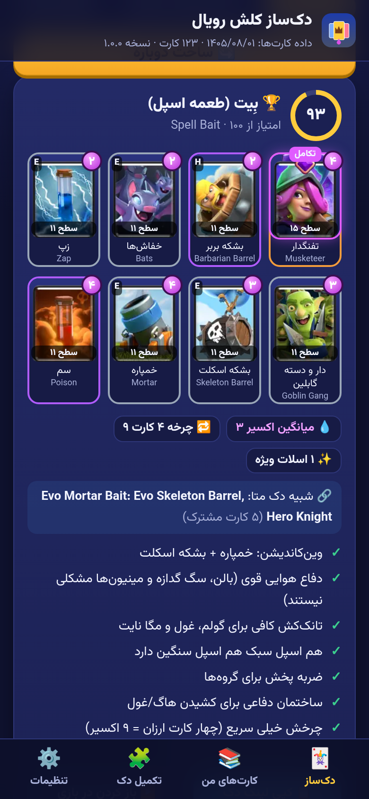

# دک‌ساز کلش رویال · Clash Deck Builder (PWA)

> اپ وب نصب‌شدنی (PWA)، فارسی و راست‌به‌چپ، که از روی کارت‌هایی که **خودتان دارید** دک‌های کلش رویال را خودکار می‌سازد و دلیل هر انتخاب را توضیح می‌دهد. داده‌ی کارت‌ها هر روز خودکار به‌روز می‌شود و کارت‌های جدید را تشخیص می‌دهد.
>
> A Persian/RTL, offline-capable PWA that auto-builds Clash Royale decks from the cards you own, explains every choice, and refreshes card data daily so new cards and new Evo/Hero forms are recognised automatically.



---

## فارسی

### چرا این اپ؟ (بررسی اپ‌های مشابه — مهر ۱۴۰۵)
| اپ / سایت | امتیاز / نصب | دک از روی کارت‌های خودم | فارسی | آفلاین | توضیح دلیل | هزینه |
|---|---|---|---|---|---|---|
| Stats Royale (iOS/Android) | ۴٫۲ (۵٬۱۹۰ رأی) | تا حدی (نیاز به تگ) | ✗ | ✗ | کم | رایگان + تبلیغ/اشتراک |
| Decks Royale | ۴٫۴ (۲٬۰۶۶) | ✗ (فهرست دک‌های متا) | ✗ | ✗ | کم | رایگان + تبلیغ |
| Clash Deck Pro / Clash Decks (iOS) | ۵٫۰ (۲) / ۱٫۳ (۳) | تا حدی | ✗ | ✗ | کم | اشتراک |
| DeckMaster AI (Android) | ۴٫۷ (+۱هزار نصب) | ✓ (با هوش مصنوعی) | ✗ | ✗ | متوسط | درون‌برنامه‌ای |
| RoyaleSmith / Clash Decks Play | +۱۰۰ / +۵هزار نصب | تا حدی | ✗ | ✗ | کم | رایگان |
| RoyaleTracker (وب) | — | ✓ ولی ۱ بار در ۲۴ ساعت، حداکثر ۳ دک | ✗ | ✗ | کم | فریمیوم |
| ElixirDeck / Deck Shop Deck Builder (وب) | — | ✓ / ارزیابی دک | ✗ | ✗ | Deck Shop: خوب | رایگان |

**شکاف‌ها:** هیچ‌کدام فارسی نیستند، هیچ‌کدام آفلاین کار نمی‌کنند، اغلب تگ بازیکن یا اشتراک یا اینترنت دائمی لازم دارند و دلیل انتخاب‌ها را توضیح نمی‌دهند. این اپ همین شکاف‌ها را پر می‌کند.

### امکانات
- **کارت‌های من:** انتخاب دستی ۱۲۳ کارت با جستجوی فارسی/انگلیسی، فیلتر (دارم/ندارم/جدید/تکامل‌دار/هیرودار، نوع، کمیابی)، سطح ۱ تا ۱۶، تکامل/هیرو، «انتخاب همه» و سطح پیش‌فرض. یا **وارد کردن با تگ بازیکن** (اختیاری، نیاز به کلید API — پایین‌تر).
- **دک‌ساز:** ۳ تا ۵ دک متنوع (سایکل، طعمه اسپل، بیت‌داون، کنترل، سیج، پل‌زنی…) با امتیاز ۱۰۰، میانگین اکسیر، هزینه‌ی چرخه‌ی ۴ کارت، اسلات‌های تکامل/هیرو/وحشی، نقاط قوت و ضعف، «شبیه دک متای …»، ریز امتیاز، **پیشنهاد جایگزینی** و **کپی لینک دک / باز کردن در بازی**.
- **تکمیل دک:** چند کارت را قفل کنید تا بقیه پر شود؛ یا دک فعلی‌تان را تحلیل کنید.
- **اولویت ارتقا:** کدام کارت را اول لول‌آپ کنید.
- **کارت جدید:** نشان «کارت جدید» / «فرم جدید»، فیلتر «جدید» و پیغام هنگام اضافه شدن کارت تازه.
- **حریم خصوصی:** همه‌چیز فقط روی دستگاه خودتان (localStorage). کلید API فقط در صورت انتخاب «به خاطر بسپار» ذخیره می‌شود. خروجی/ورودی فایل JSON برای پشتیبان.
- **آفلاین و نصب‌شدنی:** بعد از اولین باز شدن بدون اینترنت کار می‌کند (Service Worker، فونت وزیرمتن محلی، تصاویر کش‌شده). در آیفون: Safari ← Share ← Add to Home Screen.

### به‌روزرسانی خودکار و تشخیص کارت جدید
۱. **GitHub Actions روزانه** (`.github/workflows/update-data.yml`, ساعت ۰۳:۱۷ UTC) اسکریپت `scripts/update-data.mjs` را اجرا می‌کند:
   - فهرست رسمی کارت‌ها (API رسمی از طریق پراکسی RoyaleAPI اگر `CR_API_TOKEN` تنظیم شده باشد، وگرنه یک آینه‌ی عمومی از همان JSON)،
   - فهرست کارت‌های Deck Shop (کارت‌های تازه و فرم‌های تکامل/هیروی تازه را حتی قبل از آینه می‌بیند) + صفحه‌ی جزئیات هر کارت تازه برای نقش‌ها،
   - دک‌های متای صفحه‌ی اول Deck Shop.
   هیچ کارتی حذف نمی‌شود؛ کارت تازه با `added: تاریخ` و فرم تازه با `evoAdded/heroAdded` ثبت می‌شود؛ تصویرش دانلود و WebP می‌شود؛ **فقط اگر چیزی واقعاً تغییر کرده باشد** کامیت و دوباره منتشر می‌شود.
۲. **اپ** هر کارتی که در ۶۰ روز اخیر اضافه شده را با نشان «کارت جدید» نشان می‌دهد و تاریخ داده (شمسی) را در سربرگ می‌نویسد. فایل‌های داده network-first هستند، پس با اینترنت همیشه تازه‌اند.
۳. **هر دستگاه** فهرست کارت‌هایی که دیده را نگه می‌دارد؛ اگر کارت ناشناخته‌ای بیاید پیغام «کارت جدید به بازی اضافه شد» می‌دهد.
۴. کارت تازه‌ای که هنوز نقشش معلوم نیست با نقش تخمینی وارد موتور می‌شود و بعداً خودکار اصلاح می‌شود. کارت ناشناخته در خروجی API بازیکن هم گزارش می‌شود، نه خطا.

### کلید API (اختیاری، برای وارد کردن با تگ)
- در https://developer.clashroyale.com حساب بسازید، کلید جدید با IP **`45.79.218.79`** (پراکسی RoyaleAPI) بسازید و در «تنظیمات» وارد کنید.
- یا Worker کلودفلر `workers/player-proxy.js` را با secret به نام `CR_API_TOKEN` دیپلوی کنید و آدرسش را در «آدرس سرور» بگذارید تا کلید روی گوشی لازم نباشد.
- برای Action روزانه هم می‌توانید همین کلید را در Secrets مخزن با نام `CR_API_TOKEN` بگذارید (اختیاری).

### انتشار
۱. یک مخزن بسازید و کد را push کنید (شاخه‌ی `main`). ۲. Settings ← Pages ← Source: **GitHub Actions**. ۳. `pages.yml` تست‌ها را اجرا و سایت را در `https://<user>.github.io/clash-deck/` منتشر می‌کند (همه مسیرها نسبی‌اند). ۴. `update-data.yml` به مجوز write نیاز دارد (Settings ← Actions ← Workflow permissions).

### محدودیت‌ها
- لینک کپی دک فقط کارت‌ها را منتقل می‌کند؛ تکامل/هیرو را داخل بازی روی اسلات بگذارید.
- واردکردن با تگ کلید شخصی می‌خواهد و فقط با داده‌ی شبیه‌سازی‌شده تست شده است. دسترسی به سرویس‌های Supercell از ایران ممکن است VPN بخواهد؛ حالت دستی همیشه کار می‌کند.
- آینه‌ی JSON کارت‌ها و Deck Shop منابع شخص ثالث‌اند؛ اگر در دسترس نباشند داده‌ی قبلی حفظ می‌شود.
- دک‌های متا فقط از Deck Shop هستند؛ موتور مبتنی بر قاعده است (نه آمار نرخ برد زنده).
- اکسیر کارت خیلی تازه ممکن است تا به‌روزرسانی بعدی «?» باشد.

---

## English

### Features
- Manual card picker (123 cards, Persian + English names, search, filters, levels 1–16, Evo/Hero) or import by **player tag** through the official API (RoyaleAPI proxy, or your own Cloudflare Worker).
- Rule-based, explainable engine (`js/engine.js`): 3–5 diverse decks per archetype with a 0–100 score and breakdown, average elixir, 4-card cycle, Evo/Hero/Wild slot assignment (max 1 champion; 2 as an event option), pros/cons, closest Deck Shop meta deck, swap suggestions, copy-deck link / open in game, *complete my deck* with locked cards, deck analysis and upgrade priority.
- New-card recognition: daily data refresh + «کارت جدید» / «فرم جدید» badges (60 days) + per-device "new card" toast and filter.
- Offline PWA (precached shell, fonts and 184 card images), local-only storage with JSON export/import; the API key is stored only when "remember" is checked.

### Data pipeline
`scripts/update-data.mjs` merges (1) the official `/v1/cards` (via proxy when `CR_API_TOKEN` is set, else a public mirror), (2) Deck Shop's card list (detects new cards/forms early) plus one detail page per new card for roles, and (3) Deck Shop homepage meta decks. It never deletes, stamps `added`/`evoAdded`/`heroAdded`, fetches new images, and writes files only when content changed. `update-data.yml` runs it daily, runs tests, commits only on change and redeploys Pages.
Env: `CR_API_TOKEN`, `CR_API_BASE`, `CARDS_MIRROR_URL`, `DECKSHOP_BASE`, `CACHE_DIR`/`CACHE_ONLY` (offline fixtures), `DATA_DIR`, `TODAY`, `MAX_DETAIL`, `SKIP_IMAGES`.

### Develop
```bash
npm test                         # node --test: catalog, store, engine, update-script (27 tests)
npm run serve                    # python3 -m http.server
PW_DIR=/path/to/playwright-core node tests/e2e.mjs http://127.0.0.1:8080/   # 45 headless checks @390x844 → screenshots/
npm run update-data              # refresh data/ (network)
```

### Deploy
Push to `main` → Settings › Pages › Source: GitHub Actions. Optional repo secret `CR_API_TOKEN` (key whitelisted for `45.79.218.79`).

### Credits
Card data © Supercell — this is an unofficial fan project under the [Supercell Fan Content Policy](https://supercell.com/en/fan-content-policy/), not endorsed by Supercell. Roles and meta decks: [Deck Shop](https://www.deckshop.pro). Card JSON mirror: outlierSlug/immaculate-grid-engine. API proxy: [RoyaleAPI](https://docs.royaleapi.com/proxy.html). Font: Vazirmatn (OFL).
